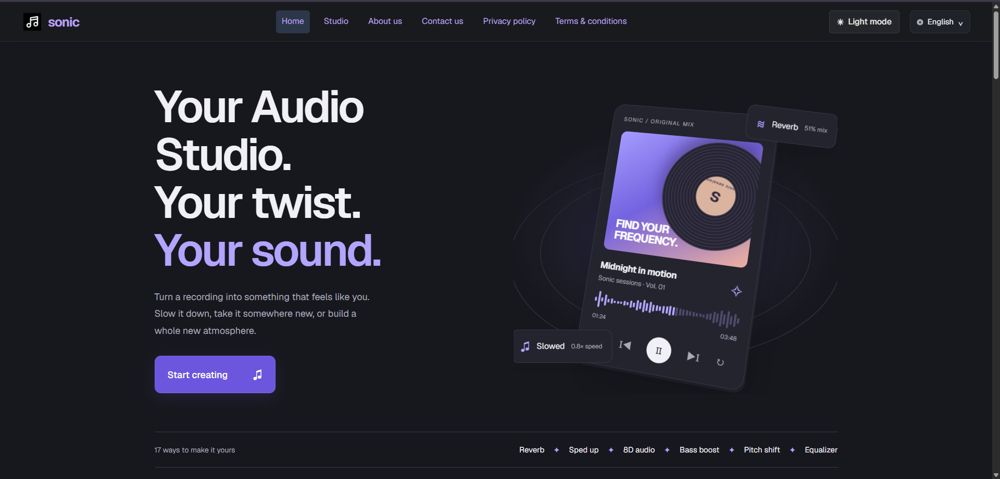

# Sonic Audio Studio




Shape your sound, right in your browser.

Apply 17 audio effects, combine them your way, and download
your creation as MP3 or WAV. Audio processing stays on your device.

[Try Audio Studio](https://sonic-audio-studio.atharva-shukla2367.workers.dev/)

## Features

- Dedicated pages for each effect, plus an editor for combining effects in order.
- Incremental processing: completed stages are cached; changes rebuild only the affected stages.
- Original/result comparison, clickable waveform seeking, and unlimited revisions.
- Quick previews of 5, 10 or 15 seconds, with a selectable start time and independent comparison playback.
- Undo/redo for effect choices, presets, enabled state and parameters; slider gestures are grouped.
- Before-and-after examples for all 24 effects, generated locally from an original synthesized sample.
- MP3 downloads at 192 kbps using a local encoding worker, or 16-bit WAV.
- Responsive layouts, mobile navigation to effect parameters, light/dark themes, and reduced-motion support.
- Animated processing progress, custom removal/leave confirmations, and contact-form feedback.
- English, Spanish, Japanese, French, German, Portuguese, Korean, and Italian pages.
- Search metadata, canonical URLs, hreflang, structured data, sitemap, and robots.txt.
- Localized error pages with HTTP status handling through Cloudflare Workers.

### Audio effects

| Space and stereo | Tone and texture | Speed and editing |
| --- | --- | --- |
| Reverb | Bass boost | Slowed + reverb |
| 8D audio | Treble | Sped up |
| 3D stereo width | 8-band equalizer | Tempo control |
| Stereo panning | Loudness | Pitch shift |
| | Telephone / radio | Reverse |
| | Distortion | Trim |
| | | 432 Hz tuning |

Additional effects: **Fade in/out, peak normalization, compressor, chorus, phaser, tremolo, and bitcrusher**. Each has adjustable parameters and its own dedicated page, and can be included anywhere in a combination chain.

## Run locally

Requires **Node.js 20 or newer**. The application and checks have no npm dependencies to install.

```sh
git clone https://github.com/atharva236723/sonic-audio-studio.git
cd sonic-audio-studio
npm run dev
```

Open **http://127.0.0.1:4173/**. Serve the project over HTTP; opening HTML files directly is unsupported because shared assets use root-relative paths.

```sh
npm run build   # Rebuild translated pages, error pages, and SEO files
npm test        # Run regression checks without external services
```

## Project structure

```text
dist/                    Website HTML, scripts, styles, icons and vendor assets
  vendor/                Bundled Lenis and lamejs, with licenses and encoder source
  es/ ja/ fr/ de/ pt/     Generated language pages
  ko/ it/
i18n/                    Translation catalogs and effect search metadata
tests/                   Portable Node.js regression checks
favicon-source/          Original favicon assets
build-i18n.cjs           Multilingual page and SEO generator
build-errors.cjs         Localized error page generator
preview.cjs              Local HTTP preview server
cloudflare-worker.mjs    Production asset routing, metadata and error handling
wrangler.jsonc           Cloudflare Workers configuration
.github/workflows/       Continuous integration
```

The English content HTML in `dist/` is the editable source. Edit those pages, shared JavaScript/CSS, or the catalogs in `i18n/`, then run `npm run build`. Generated language pages are committed so the repository includes a ready-to-serve website. Avoid editing translated output directly.

## Deploy to Cloudflare Workers

The current Worker name and live address are in [CLOUDFLARE.md](CLOUDFLARE.md). Sign in to your own Cloudflare account and select a suitable Worker name in `wrangler.jsonc` before deploying a fork.

```sh
npx wrangler@4.148.0 login
npm run build
npm test
npm run deploy
```

The Worker serves `dist/`, preserves dedicated `.html` effect URLs, and returns localized error responses. It rewrites the source's registered fallback hostname in served metadata, sitemap and robots.txt to the request origin. Set the optional `SITE_ORIGIN` Worker variable for a preferred custom domain. For a different static host, set `SONIC_SITE_URL` to the public origin before building and configure that host's error routing.

Deployment remains manual; CI only builds and tests. No credentials, OAuth tokens, local Cloudflare state, or `.env` files belong in Git.

## Verification

GitHub Actions builds all multilingual pages and runs regression checks on pushes to `main` and pull requests. Included checks cover mobile player ordering and scroll behavior, audio replacement and editable settings, MP3 export lifecycle, production routing/SEO, and Analytics tag consistency across all 296 pages.

These checks use Node.js and mocked browser interfaces. They do not replace listening tests or physical-device testing. See [VERIFICATION.md](VERIFICATION.md) for earlier signal checks and documented verification limits.

## Privacy and integrations

Audio is decoded and processed locally; the editor does not upload tracks to an audio-processing server. The deployed site uses Google Analytics and sends contact-form submissions to Formspree. Those public integration identifiers are included in the site; replace them before running your own deployment. Hosting requests and external services are described on the Privacy page.

Browser codec support varies. Upload limits are 50 MB and 10 minutes, and longer tracks require more memory. Extreme speed/pitch changes can introduce artifacts; pitch shifting does not preserve vocal formants.

## Documentation

- [Internationalization](I18N.md)
- [SEO and dedicated effect pages](SEO.md)
- [Cloudflare deployment](CLOUDFLARE.md)
- [Error page routing](ERROR-PAGES.md)
- [Verification notes](VERIFICATION.md)
- [Design reference](DESIGN.md)

## Third-party notices

Lenis is distributed with its MIT license. The unmodified lamejs encoder, its corresponding source, and LGPL notices are included in `dist/vendor/`. See [MP3-NOTICE.txt](dist/vendor/MP3-NOTICE.txt). No separate open-source license has been selected for the original application code.

## Preview and editing history

Quick preview processes an excerpt from the original through the current enabled chain in a separate pipeline. Full results, revisions and downloads remain unchanged. Timing-based effects restart on the excerpt; reverb tails and trim percentages can differ from the complete recording.

Undo/redo restores effect configurations. If a full result exists, the editor rebuilds it with the restored settings; downloads stay disabled until it is ready. Source replacement and Reset start a new history. Use the buttons, Ctrl/Cmd+Z, Ctrl/Cmd+Shift+Z or Ctrl+Y outside text fields.

Each dedicated effect page includes a locally generated six-second before/after example. The displayed example settings are independent of the uploaded audio and editor settings. Equalizer and trim examples use explicitly shown non-neutral settings.
